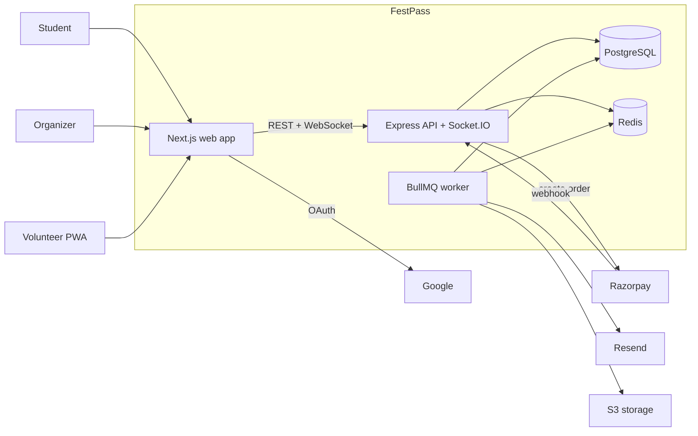
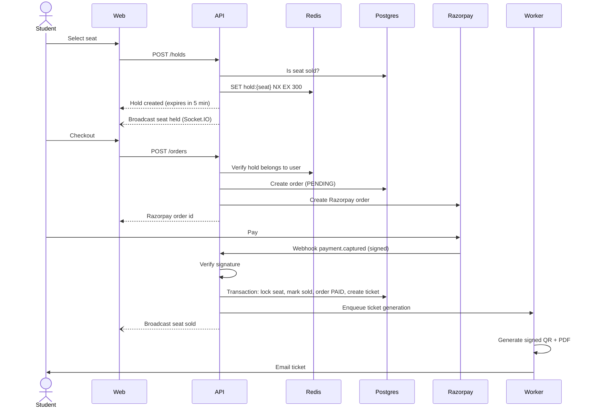

# High-Level Design

## System context

## Components

| Component  | Responsibility                                                              | State                                           |
| ---------- | --------------------------------------------------------------------------- | ----------------------------------------------- |
| `web`      | Public event pages (server rendered), booking UI, dashboards, check-in PWA  | Stateless                                       |
| `api`      | REST endpoints, auth, business rules, payment webhooks, WebSocket rooms     | Stateless; all state in Postgres and Redis      |
| `worker`   | Slow or retryable work: ticket PDFs, QR codes, emails                       | Stateless; jobs live in Redis                   |
| PostgreSQL | Source of truth: users, events, seats, orders, tickets, check-ins           | Durable                                         |
| Redis      | Seat holds (TTL), cache, rate-limit counters, job queues, Socket.IO pub/sub | Ephemeral; losing it must not lose sold tickets |

## Core flow: booking a seat

Key rules:

- **Postgres decides who gets the seat, Redis only reserves it.** A Redis hold stops others from starting checkout. The final sale is a Postgres transaction guarded by a row lock and a unique constraint, so the seat cannot be sold twice even if Redis fails. See [ADR-0004](decisions/0004-seat-holds.md).
- **The webhook is the source of truth for payment.** The browser's success callback only updates the UI. Webhooks are processed idempotently by Razorpay payment ID because they can arrive more than once.
- **Slow work leaves the request path.** Generating PDFs and sending email happen in the worker with retries, so payment confirmation stays fast.

## Core flow: check-in

1. The ticket QR encodes the ticket ID plus an HMAC signature, so a forged code is rejected without a database lookup.
2. The volunteer app verifies the signature and calls `POST /checkins`.
3. A unique constraint on `checkins.ticket_id` makes the second scan of the same ticket fail.
4. Offline, scans are queued in IndexedDB and synced on reconnect; conflicts (the same ticket scanned at two gates) are resolved by the server's unique constraint, and the later scan is reported as a duplicate.

## Scaling

The expected peak is the moment tickets go on sale: hundreds of students opening the same event page and grabbing seats within seconds.

| Pressure point       | Approach                                                                                            |
| -------------------- | --------------------------------------------------------------------------------------------------- |
| Event page reads     | Server rendering with cached event data in Redis; invalidated when the organizer edits the event    |
| Seat contention      | Redis `SET NX` rejects losing requests in under a millisecond, before they reach Postgres           |
| Many API instances   | API is stateless; Socket.IO uses the Redis adapter so a broadcast reaches clients on every instance |
| Database connections | Connection pooling; short transactions that lock only the rows involved                             |
| Abuse and bots       | Per-user and per-IP rate limits on hold and order endpoints                                         |

## Failure handling

| Failure                             | Effect                           | Handling                                                           |
| ----------------------------------- | -------------------------------- | ------------------------------------------------------------------ |
| Redis down                          | Holds and cache unavailable      | Booking endpoints return 503; sold tickets are safe in Postgres    |
| Webhook delivered twice             | Possible duplicate ticket        | Idempotent by payment ID (unique constraint)                       |
| Webhook never arrives               | Order stuck in PENDING           | Reconciliation job polls Razorpay for stale pending orders         |
| Payment succeeds after hold expired | Seat may have been taken         | If still free, confirm; otherwise mark the order for refund        |
| Worker crash mid-job                | Ticket not emailed               | BullMQ retries with backoff; failed jobs go to a dead-letter queue |
| API instance dies                   | Its WebSocket clients disconnect | Clients reconnect to another instance and refetch seat state       |
