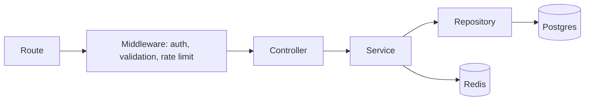

# Low-Level Design

Code structure and conventions that apply across the codebase. Feature-specific classes, schemas and endpoints are documented in [features/](features/README.md).

## Repository layout

```
festpass/
├── apps/
│   ├── web/        Next.js frontend
│   ├── api/        Express API + Socket.IO
│   └── worker/     BullMQ workers
├── packages/
│   ├── db/         Prisma schema, migrations, seed, client
│   ├── shared/     Zod schemas and types shared by web, api and worker
│   └── config/     Shared tsconfig, ESLint and Prettier presets
└── docs/
```

## API layering



| Layer      | Owns                                                                     | Must not                                     |
| ---------- | ------------------------------------------------------------------------ | -------------------------------------------- |
| Route      | URL, HTTP method, middleware order                                       | Contain logic                                |
| Controller | Reading the validated request, calling one service, shaping the response | Touch the database or Redis                  |
| Service    | Business rules, transactions, coordination between repositories          | Know about HTTP (`req`, `res`, status codes) |
| Repository | Database queries                                                         | Contain business rules                       |

Services receive their dependencies through constructors, so tests can pass in fakes without mocking modules.

## Module structure

Code is grouped by feature, not by layer:

```
apps/api/src/modules/booking/
├── booking.routes.ts
├── booking.controller.ts
├── booking.service.ts
├── booking.repository.ts
└── booking.service.test.ts
```

## Error handling

- Services throw typed errors: `NotFoundError`, `ConflictError`, `ForbiddenError`, `ValidationError`, all extending `AppError`.
- One error middleware maps them to HTTP status codes and a consistent body.
- Unknown errors are logged with the request ID and returned as a generic 500, never leaking stack traces.

Error response shape:

```json
{
  "error": {
    "code": "SEAT_ALREADY_HELD",
    "message": "This seat is being booked by someone else.",
    "requestId": "c0a8..."
  }
}
```

## Validation

- Request body, params and query are validated with Zod schemas from `packages/shared`.
- The same schemas validate forms in `web`, so client and server rules never drift.
- Environment variables are validated at startup; the process exits if any are missing or invalid.

## Conventions

| Area     | Rule                                                                     |
| -------- | ------------------------------------------------------------------------ |
| Types    | `strict` mode, no `any`; `unknown` plus narrowing at boundaries          |
| Naming   | `camelCase` in code, `snake_case` in database columns (mapped by Prisma) |
| IDs      | UUIDs for all public identifiers                                         |
| Money    | Integer paise, never floating point                                      |
| Time     | Stored in UTC; formatted in the user's timezone on the client            |
| Logging  | Pino, structured, with a request ID on every line; no `console.log`      |
| Comments | Only for non-obvious reasons; code should explain itself                 |
| Commits  | Conventional Commits (`feat(booking): ...`), enforced by commitlint      |
| Tests    | Next to the code they test (`*.test.ts`)                                 |
