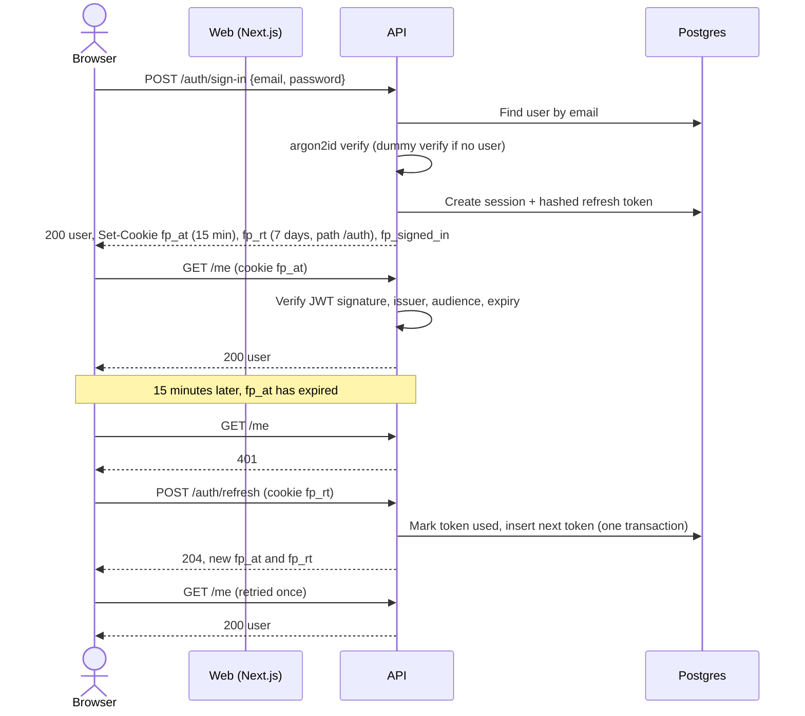
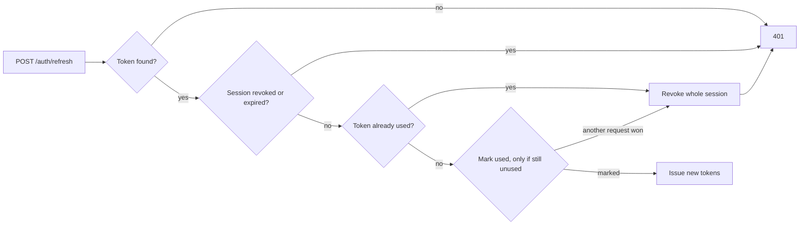

# Feature: Authentication and roles

- Status: Done
- Related ADRs: [0006](../decisions/0006-session-tokens.md)

## What it does

Students, organizers and volunteers create an account with email and password or with Google, stay signed in across visits, confirm their email, reset a forgotten password, and sign out on one or every device. The API knows who is calling and what they are allowed to do at each organization and event.

## User stories

- As a student, I want to sign up in under a minute, so that I can book before seats run out.
- As a student, I want to sign in with Google, so that I do not need another password.
- As anyone, I want to reset my password from my email, so that I am never locked out.
- As anyone, I want to sign out on every device, so that a lost phone cannot use my account.
- As an organizer, I want only my team to manage my events.
- As a volunteer, I want to scan tickets only at events I am assigned to.

## High-level design

### Sign-in and refresh

### Refresh token reuse detection

### Google sign-in

1. `GET /auth/google` creates a random `state` and a PKCE `code_verifier`, stores both in a 10-minute httpOnly cookie scoped to `/auth/google`, and redirects to Google.
2. Google redirects back to `GET /auth/google/callback?code&state`.
3. The API checks `state` against the cookie (prevents login CSRF), exchanges the code with the verifier (prevents code interception), and reads the ID token claims.
4. Account resolution:
   - Google account already linked: sign in as that user.
   - Google email not verified: refuse.
   - A user with that email exists: link Google to it and mark the email verified.
   - Otherwise: create a new, verified user.
5. Redirect to `/account` with session cookies set, or to `/sign-in?error=google` on any failure.

### Route protection in the web app

`src/proxy.ts` (Next.js proxy, formerly middleware) redirects `/account` to `/sign-in?next=/account` when the `fp_signed_in` cookie is missing, and signed-in users away from `/sign-in` and `/sign-up`. This is only a fast redirect, not security: the API checks the access token on every request, and the account page sends the user to sign in if the API answers 401.

## Low-level design

### Data model

Added in migration `auth`:

| Table                 | Purpose                                                                                              |
| --------------------- | ---------------------------------------------------------------------------------------------------- |
| `users` (new columns) | `password_hash` (null for Google-only users), `email_verified_at`                                    |
| `accounts`            | Linked external identities; unique `(provider, provider_account_id)` and one Google account per user |
| `sessions`            | One per sign-in; device info, absolute expiry, `revoked_at`                                          |
| `refresh_tokens`      | Hash, idle expiry and `used_at` for each token issued in a session                                   |
| `verification_tokens` | Hashed single-use tokens for email verification and password reset                                   |

Tokens are stored as SHA-256 hashes, so a database leak does not expose working tokens. A fast hash is enough because the tokens are 256-bit random values that cannot be guessed; slow hashing exists for low-entropy passwords.

### API

| Method | Path                        | Auth    | Description                                               |
| ------ | --------------------------- | ------- | --------------------------------------------------------- |
| POST   | `/auth/sign-up`             | None    | Create account, start session, send verification email    |
| POST   | `/auth/sign-in`             | None    | Start session                                             |
| POST   | `/auth/refresh`             | Refresh | Rotate refresh token, issue new access token              |
| POST   | `/auth/sign-out`            | Refresh | Revoke current session                                    |
| POST   | `/auth/sign-out-everywhere` | Access  | Revoke every session for the user                         |
| POST   | `/auth/verify-email`        | None    | Consume an email verification token                       |
| POST   | `/auth/verification-email`  | Access  | Send a new verification link (invalidates the old one)    |
| POST   | `/auth/forgot-password`     | None    | Send a reset link if the email exists; always 202         |
| POST   | `/auth/reset-password`      | None    | Consume reset token, set password, revoke all sessions    |
| GET    | `/auth/google`              | None    | Start Google sign-in                                      |
| GET    | `/auth/google/callback`     | None    | Finish Google sign-in                                     |
| GET    | `/me`                       | Access  | Current user with organizations and volunteer assignments |

Rate limits (per IP): sign-in 10 per 15 minutes, sign-up 10 per hour, email-sending endpoints 5 per hour.

### Modules

| Module                            | Responsibility                                                                   |
| --------------------------------- | -------------------------------------------------------------------------------- |
| `lib/password.ts`                 | argon2id hashing (OWASP parameters: 19 MiB, 2 iterations) and timing equaliser   |
| `lib/crypto.ts`                   | Random tokens and SHA-256 token hashing                                          |
| `modules/auth/access-tokens.ts`   | Sign and verify JWTs; pins `HS256`, issuer and audience                          |
| `modules/auth/auth.service.ts`    | All auth rules: sessions, rotation, reuse detection, verification, reset, Google |
| `modules/auth/auth.repository.ts` | Database access; atomic token consumption with conditional updates               |
| `modules/auth/auth.controller.ts` | HTTP: parse input, set and clear cookies, redirects for the OAuth flow           |
| `modules/auth/authorization.ts`   | Permission checks: admin, organization role, event manager, event scanner        |
| `middleware/require-auth.ts`      | Reads `fp_at`, sets `req.auth`, or 401                                           |
| `middleware/verify-origin.ts`     | Rejects cross-site state-changing requests                                       |
| `modules/auth/google.ts`          | Google OAuth client behind an interface, so tests use a fake                     |

Web: `lib/api.ts` (fetch wrapper: credentials, typed errors, single-flight refresh and one retry), `lib/auth.ts` (endpoints and `useCurrentUser`), and the pages under `app/(auth)` and `app/account`.

### Authorization rules

| Check                     | Passes for                                                             |
| ------------------------- | ---------------------------------------------------------------------- |
| `requireAdmin`            | Platform admins                                                        |
| `requireOrganizationRole` | Members with an allowed role (default: owner or organizer), and admins |
| `requireEventManager`     | Organizers of the event's organization, and admins                     |
| `requireEventScanner`     | Volunteers assigned to the event, plus event managers                  |

Roles are read from the database when checked, so a removed organizer loses access immediately rather than when their token expires.

## Decisions and trade-offs

| Decision                                                    | Why                                                                                                                              |
| ----------------------------------------------------------- | -------------------------------------------------------------------------------------------------------------------------------- |
| argon2id instead of bcrypt                                  | Memory-hard, so GPU cracking is expensive; bcrypt also silently ignores input past 72 bytes                                      |
| Dummy hash check for unknown emails                         | Without it, "no such user" answers faster than "wrong password", which leaks which emails are registered                         |
| Same error for wrong email and wrong password               | Does not reveal which accounts exist                                                                                             |
| Sign-up does reveal a taken email (409)                     | Users need to know to sign in instead. Sign-up is rate-limited to make bulk probing slow                                         |
| Forgot-password always answers 202                          | Unlike sign-up, there is no usability cost to hiding whether the email exists                                                    |
| New verification or reset link invalidates the previous one | Only the most recent email works, so an old forwarded email is useless                                                           |
| Password reset revokes every session                        | A reset usually means the password was compromised; any attacker session must end                                                |
| Password reset also verifies the email                      | Following the emailed link proves ownership of the inbox                                                                         |
| Verification page needs a button press                      | Email security scanners open links automatically; consuming the token on page load would let a scanner use it up                 |
| Google accounts link only with a verified Google email      | Otherwise an attacker could create a Google account with someone else's unverified address and take over their FestPass account  |
| `Origin` check allows requests with no `Origin`             | Browsers always send `Origin` on cross-site POSTs, so a missing header means a non-browser client, which cannot be used for CSRF |
| Rate limits use in-memory counters                          | Correct for one API instance. Moves to Redis when the API runs multiple instances (booking phase)                                |
| Emails are logged, not sent, in development                 | `EmailSender` is an interface; a real provider is added with ticket emails                                                       |

## Edge cases and failure handling

| Case                                                | Behaviour                                                                 |
| --------------------------------------------------- | ------------------------------------------------------------------------- |
| Two sign-ups with the same email at the same moment | Unique constraint rejects the second; reported as "email already exists"  |
| Refresh token used twice                            | Whole session revoked; both holders must sign in again                    |
| Session past its 30-day lifetime                    | Refresh fails with 401 and cookies are cleared                            |
| Verification or reset link reused or expired        | 400 `INVALID_TOKEN` with a prompt to request a new link                   |
| Email provider fails                                | Sign-up and reset still succeed; the error is logged; the user can resend |
| Google returns an error or the state does not match | Redirect to sign-in with an error message; no session is created          |
| Google sign-in not configured                       | Button redirects back with "not available yet"                            |
| Malformed or forged access cookie                   | 401                                                                       |
| `next` parameter pointing to another site           | Ignored; only same-site paths are followed after sign-in                  |

## Testing

- **Unit:** password hashing parameters and salting; JWT signing, expiry, wrong secret, wrong issuer or audience, malformed input; environment parsing.
- **Integration (Supertest + real Postgres):** every endpoint above, including rotation, reuse detection, expiry, sign-out everywhere, single-use and expiring links, email enumeration resistance, rate limiting, cookie flags, cross-origin rejection, and the full Google flow with a fake provider.
- **Authorization:** each permission check against owners, organizers, volunteers, strangers and admins.
- **Manual (browser):** sign-up with validation, email confirmation, sign-out, wrong and right password, `next` redirect, route guards, mobile and dark mode.

## Interview questions

**Why not keep the JWT in localStorage?**
Any script running on the page can read localStorage, so a single XSS bug would leak every session. httpOnly cookies cannot be read by JavaScript at all.

**If cookies are sent automatically, what stops CSRF?**
Two layers. `SameSite=Lax` means browsers do not attach the cookies to cross-site POST requests. And the API rejects any state-changing request whose `Origin` header is not the web app.

**How does refresh token rotation detect theft?**
Each refresh token works once. If an attacker copies a token and either side uses it, the next use of the same token by the other side is a reuse, which can only happen if the token was copied. The server then revokes the session, cutting off both.

**Why is the access token only 15 minutes?**
It is verified without a database lookup, so it cannot be revoked. A short lifetime limits how long a stolen or signed-out token keeps working.

**Why hash refresh tokens with SHA-256 but passwords with argon2?**
Passwords are guessable, so hashing must be slow to make guessing expensive. Refresh tokens are 256 random bits, impossible to guess, so a fast hash is enough to make a leaked database useless.

**What is PKCE and why use it with a confidential client?**
The client sends a hash of a secret verifier when starting the flow and the verifier itself when exchanging the code. A stolen authorization code is useless without the verifier. It is recommended for all OAuth clients now, not only public ones.

**How do you stop someone finding out which emails are registered?**
Sign-in gives the same error and takes the same time for an unknown email and a wrong password, and forgot-password always answers the same way. Sign-up does reveal it, which is a deliberate usability trade-off protected by rate limiting.

**Where is authorization enforced?**
In the API services, against the database, on every request. The web app's route guard only improves the experience; skipping it gets an attacker a page that immediately fails to load data.
