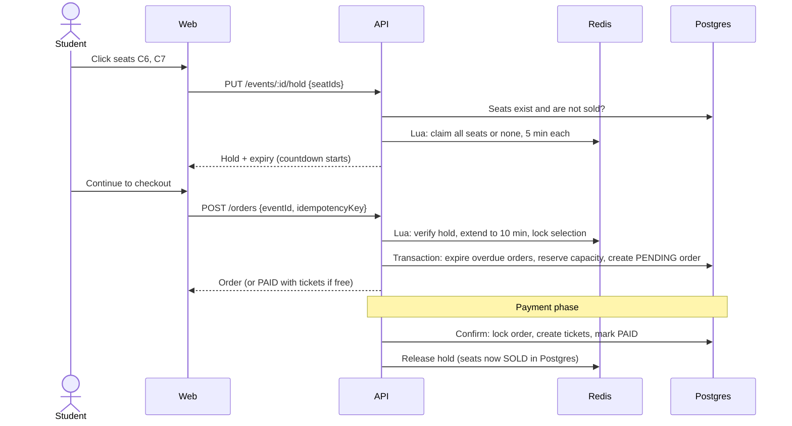
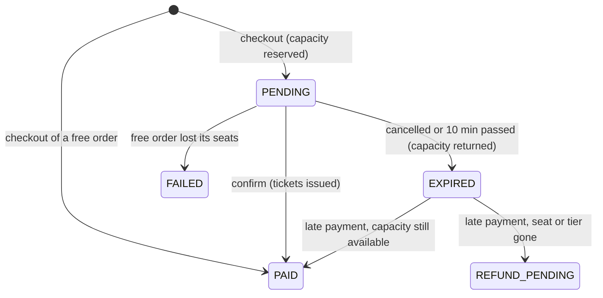

# Feature: Seat holds and booking

- Status: Done (payments: see [payments.md](payments.md))
- Related ADRs: [0004](../decisions/0004-seat-holds.md), [0005](../decisions/0005-database-enforced-invariants.md), [0008](../decisions/0008-reserve-at-checkout.md)

## What it does

Students pick seats on the seat map (or quantities for general admission), get them held for five minutes, check out into a ten-minute payment window, and receive tickets when the order is confirmed. Free orders are confirmed immediately. Seats that are not paid for return to sale automatically.

The core guarantee: **no seat or ticket is ever sold twice**, however many students click at the same moment.

## High-level design



### Who decides what

| Concern                           | Decided by                                   | Why                                                                   |
| --------------------------------- | -------------------------------------------- | --------------------------------------------------------------------- |
| Who is choosing a seat right now  | Redis hash with per-seat expiry              | Thousands of clicks in the first minute of sales; expiry is automatic |
| How many tickets are committed    | `ticket_tiers.sold_count` + CHECK constraint | Atomic, transactional, survives restarts                              |
| Whether a seat is sold            | Partial unique index on active tickets       | Cannot be bypassed by any code path                                   |
| Whether a checkout request is new | Unique `(user_id, idempotency_key)`          | Double-clicks and retries return the same order                       |

Redis makes the common case fast; Postgres makes every case correct. If Redis lost all its data, the worst outcome is two students reaching checkout for one seat, and the second confirmation is refused by the database.

### Order lifecycle



## Low-level design

### Redis keys

All keys for an event share the hash tag `{event:<id>}`, so they live on one cluster slot and Lua scripts can touch them together.

| Key                               | Type   | Contents                             | Expiry                   |
| --------------------------------- | ------ | ------------------------------------ | ------------------------ |
| `{event:<id>}:held`               | Hash   | seat ID → user ID                    | Per field (`HPEXPIRE`)   |
| `{event:<id>}:selection:<userId>` | Set    | The user's held seat IDs             | Same as the user's seats |
| `{event:<id>}:checkout:<userId>`  | String | Idempotency key of the open checkout | End of checkout window   |
| `rate-limit:<name>:<ip>`          | String | Request counter                      | Rate-limit window        |

### Lua scripts

| Script    | Does atomically                                                                                                                                               |
| --------- | ------------------------------------------------------------------------------------------------------------------------------------------------------------- |
| `HOLD`    | Refuse if a checkout is open; report every requested seat owned by someone else; otherwise drop seats no longer wanted, claim the new set, reset expiry       |
| `CLAIM`   | Accept a retry of the same checkout; verify the user still owns every selected seat; extend seats and selection to the checkout deadline; record the checkout |
| `RELEASE` | Delete only the seats this user still owns, plus the selection and checkout keys                                                                              |

Scripts run as a single Redis command, so no other client can act between the check and the write. That is what makes "50 students click the same seat, exactly one wins" true.

### Postgres transactions

**Create order**

```sql
-- 1. expire this event's overdue checkouts and return their capacity (one statement, CTEs)
-- 2. UPDATE ticket_tiers SET sold_count = sold_count + n WHERE id = ...   -- per tier, in ID order
--    CHECK (sold_count <= capacity) rejects overselling
-- 3. INSERT order (PENDING, expires in 10 min) and order_items (prices snapshotted)
```

**Confirm**

```sql
SELECT ... FROM orders WHERE id = $1 FOR UPDATE   -- serialises confirmations of one order
-- PAID already: return (idempotent)
-- EXPIRED: take capacity again (late payment)
INSERT INTO tickets ...                           -- partial unique index rejects a resold seat
UPDATE orders SET status = 'PAID', paid_at = now()
```

If the insert or capacity check fails, a second transaction marks the order `REFUND_PENDING` (or `FAILED` when nothing was paid) and returns any reservation.

**Expire** runs every 15 seconds as a scheduled worker job (see [tickets.md](tickets.md)), and also inside every checkout for that event:

```sql
WITH expired AS (
  UPDATE orders SET status = 'EXPIRED' WHERE status = 'PENDING' AND expires_at <= now()
  RETURNING id, user_id, event_id
), released AS (
  UPDATE ticket_tiers SET sold_count = sold_count - totals.quantity
  FROM (SELECT tier_id, SUM(quantity) FROM order_items WHERE order_id IN (SELECT id FROM expired) GROUP BY tier_id) totals
  WHERE ticket_tiers.id = totals.tier_id
)
SELECT * FROM expired;
```

Because the status change is conditional (`WHERE status = 'PENDING'`), several API instances can run the sweep at once and each order is expired, and its capacity returned, exactly once.

### API

| Method | Path                      | Auth | Description                                               |
| ------ | ------------------------- | ---- | --------------------------------------------------------- |
| GET    | `/events/:eventId/hold`   | User | Your held seats, expiry, and any open checkout's order ID |
| PUT    | `/events/:eventId/hold`   | User | Replace your selection (empty list releases it)           |
| POST   | `/orders`                 | User | Check out: `{eventId, idempotencyKey, items?}`            |
| GET    | `/orders/:orderId`        | User | Your order with items and tickets                         |
| POST   | `/orders/:orderId/cancel` | User | Cancel an unpaid checkout and release seats               |
| GET    | `/events/:slug/seats`     | None | Now also reports `HELD` seats                             |

Limits: 10 seats per hold, each tier's `max_per_order`, 20 tickets per order. Rate limits (now stored in Redis, shared by all API instances): 60 hold changes and 10 checkouts per minute per IP.

### Web

| Piece               | Behaviour                                                                                                    |
| ------------------- | ------------------------------------------------------------------------------------------------------------ |
| Seat map            | Seats are `role="checkbox"` with full labels; one tab stop with arrow-key movement; Space or Enter toggles   |
| Selection           | Updates instantly on click; hold requests run one at a time in click order, so the last click wins           |
| Live state          | Pushed over WebSockets as seats change (see [realtime.md](realtime.md)); a 60-second refresh is the fallback |
| Countdown           | Shows the hold or checkout time left; when it reaches zero the page reloads the hold and explains why        |
| Resume              | Returning to an event with an open checkout shows a link back to it                                          |
| Signed-out visitors | Can browse the map; choosing a seat asks them to sign in and brings them back                                |

## Decisions and trade-offs

| Decision                                                                             | Why                                                                                                                       |
| ------------------------------------------------------------------------------------ | ------------------------------------------------------------------------------------------------------------------------- |
| Redis hash with per-field TTL instead of one key per seat                            | One `HKEYS` returns every held seat of an event; per-key holds would need `SCAN` over thousands of keys on every map load |
| Lua scripts instead of `WATCH`/`MULTI`                                               | Optimistic transactions retry under contention, which is exactly the busiest moment; a script never retries               |
| The client sends the whole selection, not "add seat"                                 | Makes each request idempotent and the last request authoritative                                                          |
| Selection locked during checkout                                                     | The order's seats and the hold must stay identical; students cancel to change seats                                       |
| Capacity reserved at checkout ([ADR-0008](../decisions/0008-reserve-at-checkout.md)) | Students reaching the payment page are guaranteed their tickets                                                           |
| CHECK constraint as the oversell guard instead of `SELECT ... FOR UPDATE`            | `UPDATE ... SET sold_count = sold_count + n` already row-locks; the constraint turns "too many" into a clean error        |
| Tiers updated in ID order                                                            | Two orders touching the same tiers always lock them in the same order, so they cannot deadlock                            |
| Expiry sweep inside the API for now                                                  | No worker process yet; the sweep is safe to run on many instances and moves to the background worker later                |
| The seat map is a view, never the authority                                          | Correctness never depends on the map being fresh; Redis and Postgres decide every hold and sale                           |

## Edge cases and failure handling

| Case                                                    | Behaviour                                                                                  |
| ------------------------------------------------------- | ------------------------------------------------------------------------------------------ |
| 50 students click the same seat at once                 | Exactly one hold succeeds; the rest get `409 SEATS_UNAVAILABLE` naming the seat            |
| 10 students buy the last 5 general admission tickets    | Exactly 5 orders are created; `sold_count` ends at 5                                       |
| Double-clicked "Continue"                               | Same idempotency key, same order                                                           |
| Hold expires before checkout                            | `409 HOLD_EXPIRED`, "Choose your seats again"                                              |
| Seat sold while it sat in a stale hold                  | Checkout re-checks Postgres and refuses; the hold is cleared                               |
| Payment arrives after the order expired and seat resold | Order becomes `REFUND_PENDING`; the other student keeps the seat; no duplicate ticket      |
| Confirmation runs twice (retried webhook)               | Second run sees `PAID` under the row lock and does nothing                                 |
| API crashes mid-checkout                                | The transaction rolls back; the Redis checkout lock expires at the deadline                |
| Redis unavailable                                       | Hold and checkout fail with 500 and nothing is sold; sold seats in Postgres are unaffected |
| Sales closed or event cancelled                         | `409 SALES_CLOSED`                                                                         |

## Testing

- **Redis store (10 tests, real Redis):** holds, conflicts, replacing a selection, 50-way race, automatic expiry, checkout claim, retries, releasing only your own seats.
- **Orders (20 tests, real Postgres and Redis):** holds and limits, sales window, checkout and capacity reservation, selection lock, idempotent retry, confirmation and seat status, repeated confirmation, late payment after resale, cancellation, expiry sweep, ownership, general admission limits, 10-way race for 5 tickets, free orders.
- **Mutation check:** skipping the capacity reservation or ignoring the "seat taken" error makes 8 tests fail.
- **Manual (browser):** mouse and keyboard seat selection, cross-user held state, checkout, resume link, cancellation releasing capacity, free ticket, per-person limit, mobile layout.

## Interview questions

**How do you stop two people booking the same seat?**
Three layers. A Redis Lua script grants a seat to exactly one user at a time, and since the script runs as one command nobody can act between the check and the claim. Checkout re-checks Postgres. And a partial unique index allows only one active ticket per seat, so even a bug or a Redis failure cannot produce a double booking.

**Why Lua instead of a Redis transaction?**
`MULTI` cannot branch on values it reads, and `WATCH` aborts and retries when a watched key changes, which happens constantly when everyone wants the same seats. A script reads, decides and writes in one step with no retries.

**How does general admission avoid overselling without locks?**
Each order runs `UPDATE ticket_tiers SET sold_count = sold_count + n`. Postgres row-locks the tier during the update, so concurrent orders queue, and the CHECK constraint `sold_count <= capacity` rejects the one that would go over. Ten concurrent buyers for five tickets produce exactly five orders.

**What happens if a payment arrives after the checkout expired?**
Confirmation locks the order and sees it expired. It tries to take the capacity again; if the seat was resold, the ticket insert hits the unique index, the transaction rolls back, and the order becomes `REFUND_PENDING`. Nobody loses a seat they paid for, and no seat is sold twice.

**What makes checkout idempotent?**
The client generates an idempotency key per checkout attempt. A unique constraint on `(user_id, idempotency_key)` means a retried request finds the existing order instead of creating a second one, even if both requests arrive at the same moment.

**Why can many API instances run the expiry job safely?**
The job's `UPDATE ... WHERE status = 'PENDING' AND expires_at <= now()` changes each order once; a second instance finds nothing left to update. Capacity is returned in the same statement, based only on the rows that instance actually changed.

**How do you prevent deadlocks when an order touches several tiers?**
Every transaction updates tiers sorted by ID. Two transactions that need the same tiers always lock them in the same order, so neither can wait on the other in a cycle.
