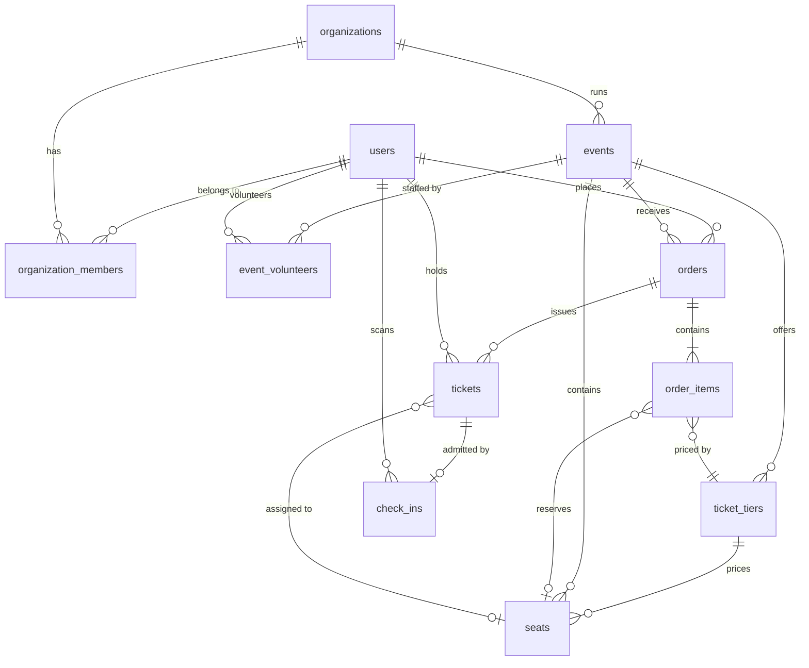

# Feature: Database schema

- Status: Done
- Related ADRs: [0003](../decisions/0003-postgres-prisma.md), [0004](../decisions/0004-seat-holds.md), [0005](../decisions/0005-database-enforced-invariants.md)

## What it does

Defines how FestPass stores organizations, events, ticket tiers, seats, orders, tickets and check-ins, and makes the database itself refuse data that would break the booking rules.

## Entity relationships

## Tables

| Table                                                           | Purpose                                                      | Notes                                                                                                     |
| --------------------------------------------------------------- | ------------------------------------------------------------ | --------------------------------------------------------------------------------------------------------- |
| `users`                                                         | Everyone who uses FestPass                                   | `role` is only `USER` or `ADMIN`; other roles come from relationships                                     |
| `organizations`                                                 | A club or fest committee that runs events                    | URL-safe `slug`                                                                                           |
| `organization_members`                                          | Who can manage an organization's events                      | `OWNER` or `ORGANIZER`                                                                                    |
| `events`                                                        | One show, competition or session                             | `RESERVED` (seat map) or `GENERAL_ADMISSION` (tiers with capacity); `DRAFT`, `PUBLISHED`, `CANCELLED`     |
| `event_volunteers`                                              | Who may scan tickets at an event, and at which gate          | Composite primary key `(event_id, user_id)`                                                               |
| `ticket_tiers`                                                  | A price level: "Platinum", "Early bird"                      | `capacity` and `sold_count` for general admission; `max_per_order` caps one order                         |
| `seats`                                                         | One physical seat with its grid position for the seat map    | `x`, `y` for rendering; `is_accessible`                                                                   |
| `orders`                                                        | A checkout attempt and its payment                           | `PENDING` → `PAID`, or `EXPIRED`/`FAILED`; refund states; Razorpay IDs                                    |
| `order_items`                                                   | What an order is for: one row per seat, or a tier × quantity | `unit_price_in_paise` snapshots the price at purchase time                                                |
| `tickets`                                                       | Proof of entry, one per person                               | `ACTIVE` or `CANCELLED`; the QR code is derived from the ticket ID                                        |
| `accounts`, `sessions`, `refresh_tokens`, `verification_tokens` | Sign-in identities and sessions                              | See [Authentication](auth.md)                                                                             |
| `check_ins`                                                     | A successful scan at the gate                                | `device_scanned_at` keeps the phone's time for offline scans; `created_at` is when the server accepted it |

## Invariants

Each rule is enforced by the database and covered by a test in `packages/db/src/constraints.test.ts`.

| Rule                                                         | Constraint                                                                  | Type           |
| ------------------------------------------------------------ | --------------------------------------------------------------------------- | -------------- |
| A seat has at most one active ticket                         | `tickets_active_seat_key` on `seat_id WHERE status = 'ACTIVE'`              | Partial unique |
| Cancelling a ticket frees its seat                           | Same partial index: cancelled tickets are not included                      | Partial unique |
| A ticket is checked in at most once                          | `check_ins_ticket_id_key`                                                   | Unique         |
| A tier never sells past capacity                             | `ticket_tiers_capacity_check`: `sold_count <= capacity`                     | Check          |
| A payment is applied to one order                            | `orders_razorpay_payment_id_key`                                            | Unique         |
| Retrying checkout does not create a second order             | `orders_user_id_idempotency_key_key`                                        | Unique         |
| A seat's tier belongs to the same event                      | `seats_tier_id_event_id_fkey` on `(tier_id, event_id)`                      | Composite FK   |
| A ticket's event matches its order's event                   | `tickets_order_id_event_id_fkey` on `(order_id, event_id)`                  | Composite FK   |
| A check-in's event matches its ticket's event                | `check_ins_ticket_id_event_id_fkey`                                         | Composite FK   |
| Paid orders have a payment time; unpaid ones do not          | `orders_paid_at_check`                                                      | Check          |
| Cancelled tickets have a cancellation time; active ones not  | `tickets_cancellation_check`                                                | Check          |
| A seated order item is for exactly one seat                  | `order_items_quantity_check`                                                | Check          |
| Events end after they start; sales close before the end      | `events_schedule_check`, `events_sales_window_check`                        | Check          |
| Emails are stored lowercase, so lookups are case-insensitive | `users_email_lowercase_check`                                               | Check          |
| Prices and totals are never negative                         | `ticket_tiers_price_check`, `orders_total_check`, `order_items_price_check` | Check          |

## Indexes

Every index exists for a query FestPass will run:

| Index                                    | Query it serves                                                    |
| ---------------------------------------- | ------------------------------------------------------------------ |
| `events (status, starts_at)`             | Upcoming published events, soonest first                           |
| `events (organization_id)`               | An organizer's event list                                          |
| `orders (user_id, created_at DESC)`      | "My orders", newest first                                          |
| `orders (event_id, status)`              | Sales figures for an event dashboard                               |
| `orders (expires_at) WHERE PENDING`      | Expiry job finding abandoned checkouts; partial, so it stays small |
| `tickets (event_id, status)`             | Attendee lists and check-in counts                                 |
| `tickets (holder_id)`                    | "My tickets"                                                       |
| `check_ins (event_id, created_at)`       | Live check-in feed for the organizer dashboard                     |
| `seats (event_id, section, row, number)` | Unique seat position; also loads the whole seat map for an event   |

Foreign key columns that are not the leading column of another index (`seats.tier_id`, `order_items.order_id`, `order_items.seat_id`, `tickets.order_id`) have their own index, because Postgres does not index foreign keys automatically and deletes or joins on them would scan the table.

## Decisions and trade-offs

| Decision                                        | Why                                                                                                                                                           |
| ----------------------------------------------- | ------------------------------------------------------------------------------------------------------------------------------------------------------------- |
| UUIDv7 primary keys                             | Not guessable in URLs like sequential IDs, but time-ordered, so inserts land at the end of the B-tree index instead of random pages as UUIDv4 would           |
| Money as integer paise                          | Floating point cannot represent 0.1 exactly; ₹499 is stored as `49900`                                                                                        |
| `timestamptz` everywhere                        | Stores an absolute instant; each event keeps its `timezone` for display                                                                                       |
| Roles from relationships, not a role column     | A user can organize one club's events, volunteer at another event, and book a ticket, without conflicting role flags                                          |
| Seat sold-ness derived from tickets, not a flag | One source of truth. A `seats.status` column could disagree with the tickets table; the partial unique index makes the ticket the only record of a sale       |
| `sold_count` counter on tiers                   | General admission has no seat rows to lock, so capacity is enforced by an atomic `UPDATE ... SET sold_count = sold_count + n` guarded by the CHECK constraint |
| Price snapshot on `order_items`                 | If an organizer changes a tier's price, existing orders keep the price the student paid                                                                       |
| `ON DELETE RESTRICT` for anything financial     | Orders, tickets and check-ins are records of money and attendance; deleting a user or event must not silently delete them                                     |
| Prisma `partialIndexes` preview feature         | Lets the partial unique index live in the schema, so Prisma keeps it in sync instead of a hand-written index that a later migration might drop                |
| Prisma driver adapter (`@prisma/adapter-pg`)    | Prisma 7 talks to Postgres through the `pg` driver instead of a separate query engine binary                                                                  |

## Seed data

`pnpm db:seed` resets the development database to a fictional college fest:

- Utsav 2027: Pro Night, a 360-seat auditorium in three sections and three price tiers, with two seats already sold
- Battle of the Bands (general admission, early-bird and regular tiers) with one pending checkout
- A free 24-hour hackathon limited to one pass per person, and a draft event not yet published
- Freshers' Night 2026, a past event with three attendees, two of them checked in

Dates are relative to the day the seed runs, so upcoming events stay upcoming. The seed refuses to run when `NODE_ENV=production`.

## Testing

- Integration tests run against separate databases (`festpass_test` for this package, `festpass_api_test` for the API), created automatically by `prepareTestDatabase()` in `@festpass/db/testing`. Separate databases let Turborepo run both test suites in parallel.
- Before the run, the test schema is dropped and rebuilt with `prisma migrate deploy`, so tests always use the real migrations, including hand-written CHECK constraints. The setup refuses any database whose name does not end in `_test`.
- Tables are truncated before each test, and test files run one at a time, so tests cannot affect each other.
- CI runs the same tests against a Postgres service container.

## Interview questions

**How do you stop two people from buying the same seat?**
In the database, a partial unique index allows only one `ACTIVE` ticket per seat. Even if two requests pass every application check at the same moment, the second insert fails. The booking flow adds a Redis hold and a row lock on top, so users see a clear message early, but correctness does not depend on them. See [ADR-0004](../decisions/0004-seat-holds.md).

**Why a partial unique index instead of a plain unique index on `seat_id`?**
A plain one would block reselling a seat after its ticket is cancelled. The partial index only covers active tickets, so cancelled tickets keep their history and the seat becomes available again.

**What is a composite foreign key, and why use one here?**
A foreign key on two columns. `seats (tier_id, event_id)` references `ticket_tiers (id, event_id)`, so a seat cannot be priced by another event's tier. A single-column key would only check that the tier exists.

**How do you prevent overselling general admission?**
One atomic statement, `UPDATE ticket_tiers SET sold_count = sold_count + 2 WHERE id = $1`, with a CHECK constraint `sold_count <= capacity`. Postgres row-locks the tier during the update, so concurrent purchases are applied one after another, and the one that would exceed capacity fails.

**Why UUIDv7 rather than auto-increment or UUIDv4?**
Auto-increment IDs leak business data (order 1042 means about 1,000 orders) and are guessable. UUIDv4 is random, which scatters inserts across the index. UUIDv7 starts with a timestamp, so it is unguessable and still inserts in order.

**Why store the price on the order item when the tier already has one?**
The tier's price can change. The order must keep what was actually charged, for receipts and refunds.

**How do you test database constraints?**
Against a real Postgres database with the real migrations. Each test sets up valid data, attempts one invalid write, and asserts the exact constraint name that rejected it, so a test cannot pass because of an unrelated error.
