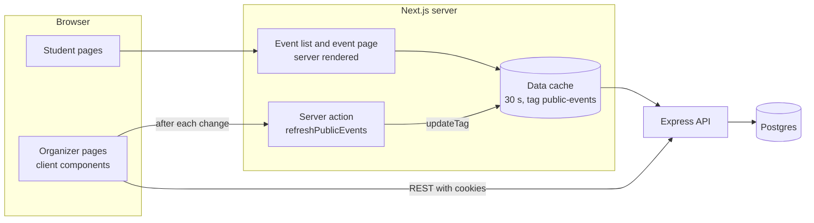
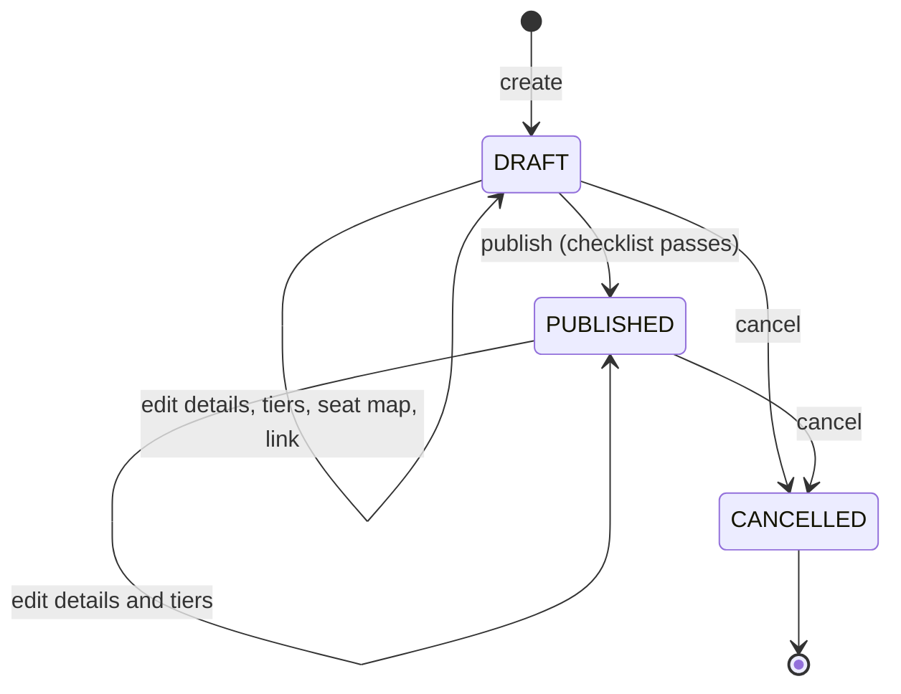

# Feature: Events and seat maps

- Status: Done
- Related ADRs: [0005](../decisions/0005-database-enforced-invariants.md), [0007](../decisions/0007-tier-capacity.md)

## What it does

Organizers create an event as a draft, add ticket tiers (price levels), build a seat map for reserved seating, and publish when a checklist passes. Students browse upcoming events, open an event page with prices, availability and the seat map, and share its link.

## User stories

- As an organizer, I want to draft an event privately and publish only when it is complete.
- As an organizer, I want to lay out a hall as sections and rows, and see the result before saving.
- As an organizer, I want edits that would break sold tickets to be blocked, not silently applied.
- As a student, I want to see upcoming events soonest first, with prices and whether they are sold out.
- As a student, I want event times shown in the event's local time, wherever I open the link.

## High-level design



- Public pages are rendered on the server so search engines and link previews see the title, date and description. API responses are cached for 30 seconds and tagged `public-events`.
- Organizer pages are client components that call the API directly with the session cookies. After every successful change they call a Server Action that expires the `public-events` tag, so the public pages show the change on the next request instead of up to 30 seconds later.

### Event lifecycle



| Rule                                               | Why                                                         |
| -------------------------------------------------- | ----------------------------------------------------------- |
| Drafts are invisible publicly (404)                | Organizers can prepare without leaking unfinished details   |
| The link (slug) is fixed after publishing          | People may have shared it                                   |
| Seating type is fixed at creation                  | Switching between seats and capacity would invalidate tiers |
| The seat map is fixed after the first booking      | Rebuilding it would delete seats that tickets point to      |
| A tier with sales cannot be deleted                | Orders and tickets reference it                             |
| Capacity cannot drop below tickets sold            | Enforced by the `ticket_tiers_capacity_check` constraint    |
| Cancelled events stay reachable by link, read-only | Ticket holders need to see the cancellation notice          |

### Publish checklist

Computed by the API (`publishIssues`) and shown on the organizer page:

- Sales must close in the future.
- At least one tier.
- General admission: every tier has a capacity.
- Reserved seating: a seat map exists, and every tier has seats assigned.

Publishing with open issues returns `409 EVENT_NOT_READY` with the list, so the web checklist and the API rule cannot disagree.

## Low-level design

### Seat map layout

Organizers describe a hall, not coordinates:

```json
{
  "sections": [
    {
      "name": "Centre",
      "rows": [
        { "label": "A", "seatCount": 12, "tierId": "...", "accessibleSeats": [1, 12] },
        { "label": "B", "seatCount": 14, "tierId": "..." }
      ]
    }
  ]
}
```

`layoutSeatMap` (in `packages/shared`) turns this into seats with grid positions:

- Sections sit side by side, separated by a two-column aisle.
- Each row is centred within its section's widest row.
- Seats are numbered from 1, left to right.

`describeSeatMap` does the reverse, rebuilding the definition from saved seats so the editor can load an existing map. A round-trip test guarantees the two agree. The same function runs in the browser for the live preview and on the server when saving, so the preview is exactly what gets stored.

Limits: 8 sections, 40 rows per section, 60 seats per row, 5,000 seats per event.

### Pagination

`GET /events` uses **keyset (cursor) pagination** ordered by `(starts_at, id)`:

```sql
WHERE status = 'PUBLISHED' AND ends_at > now()
  AND (starts_at > $cursorStartsAt OR (starts_at = $cursorStartsAt AND id > $cursorId))
ORDER BY starts_at, id
LIMIT $limit + 1
```

The cursor is the last row's `(starts_at, id)`, base64url-encoded. Fetching `limit + 1` rows tells whether there is a next page without a count query. `id` breaks ties between events starting at the same moment, so no event is skipped or repeated. A tampered cursor is rejected with 422.

### Time zones

Each event stores its IANA time zone. Organizers type local times into `datetime-local` inputs; the web app converts them to UTC with `zonedLocalToUtc`, which uses the offset in force on that date (daylight saving included). Every display formats in the event's zone, so a student abroad sees the time printed on the poster.

### API

| Method | Path                               | Auth    | Description                                    |
| ------ | ---------------------------------- | ------- | ---------------------------------------------- |
| GET    | `/events?limit&cursor`             | None    | Upcoming published events, soonest first       |
| GET    | `/events/:slug`                    | None    | Published or cancelled event with tiers        |
| GET    | `/events/:slug/seats`              | None    | Seats with `AVAILABLE` or `SOLD` status        |
| GET    | `/manage/organizations/:id/events` | Manager | All events of an organization, drafts included |
| POST   | `/manage/organizations/:id/events` | Manager | Create a draft                                 |
| GET    | `/manage/events/:id`               | Manager | Event with seat map definition and checklist   |
| PATCH  | `/manage/events/:id`               | Manager | Edit details (and link while draft)            |
| POST   | `/manage/events/:id/publish`       | Manager | Publish if the checklist passes                |
| POST   | `/manage/events/:id/cancel`        | Manager | Cancel                                         |
| GET    | `/manage/events/:id/seats`         | Manager | Seats, including for drafts                    |
| PUT    | `/manage/events/:id/seat-map`      | Manager | Replace the whole seat map                     |
| POST   | `/manage/events/:id/tiers`         | Manager | Add a tier                                     |
| PATCH  | `/manage/events/:id/tiers/:tierId` | Manager | Edit a tier                                    |
| DELETE | `/manage/events/:id/tiers/:tierId` | Manager | Delete a tier with no sales and no seats       |

"Manager" means an owner or organizer of the event's organization, or a platform admin. Malformed IDs return 404 rather than reaching Postgres.

### Modules

| Module                                               | Responsibility                                                   |
| ---------------------------------------------------- | ---------------------------------------------------------------- |
| `packages/shared/src/events.ts`                      | Zod schemas for events, tiers and seat maps; response types      |
| `packages/shared/src/seat-map.ts`                    | `layoutSeatMap`, `describeSeatMap`                               |
| `packages/shared/src/time.ts`                        | Time zone conversion, date and price formatting                  |
| `api/src/modules/events/event-catalog.service.ts`    | Public reads: listing, event page, seat statuses                 |
| `api/src/modules/events/event-management.service.ts` | Organizer writes and every lifecycle rule above                  |
| `api/src/modules/events/events.repository.ts`        | Queries, keyset pagination, seat map replacement transaction     |
| `api/src/lib/slug.ts`, `api/src/lib/cursor.ts`       | Slug generation with numbered suffixes; cursor encoding          |
| `web/src/components/seat-map/seat-map.tsx`           | SVG seat map: stage, section and row labels, seat states, legend |
| `web/src/app/organize/...`                           | Organizer dashboard, event form, tier editor, seat map editor    |

## Decisions and trade-offs

| Decision                                            | Why                                                                                                                                        |
| --------------------------------------------------- | ------------------------------------------------------------------------------------------------------------------------------------------ |
| Seat map described as sections and rows             | Matches how organizers think about a hall; a drag-and-drop canvas would take weeks and is not needed for college auditoriums               |
| Replace the whole seat map instead of editing seats | Simple and atomic; safe because the map locks after the first booking                                                                      |
| Reserved tiers store capacity = seat count          | One availability rule for both event types, no per-request counting ([ADR-0007](../decisions/0007-tier-capacity.md))                       |
| Keyset pagination instead of `OFFSET`               | `OFFSET` gets slower with depth and skips or repeats rows when events are added between page loads                                         |
| Slug from title with numbered suffix on collision   | Readable links (`/events/utsav-2027-pro-night`); the unique constraint decides races, and the service retries with the next number         |
| SVG for the seat map                                | Crisp at any zoom, styleable with design tokens, and each seat can carry an accessible label                                               |
| On-demand cache expiry after organizer edits        | Public pages stay cached for speed but reflect changes immediately. The Server Action only expires a cache tag, so calling it does no harm |
| Event caching in Redis deferred                     | The Next.js data cache already absorbs repeated reads; Redis arrives with seat holds in the booking phase                                  |

## Edge cases and failure handling

| Case                                               | Behaviour                                                                      |
| -------------------------------------------------- | ------------------------------------------------------------------------------ |
| Two events with the same title                     | Second gets `-2`, then `-3`, and so on                                         |
| End before start, or sales closing after the event | 422 with the message on the right field; checked in the browser and the API    |
| Unknown time zone                                  | 422 `Choose a valid time zone.`                                                |
| Seat map row uses another event's tier             | 422 on that row (`sections.0.rows.1.tierId`)                                   |
| Seat map edited after a booking                    | 409 `SEAT_MAP_LOCKED`                                                          |
| Tier deleted while still in the seat map           | 409 `TIER_IN_SEAT_MAP`                                                         |
| Capacity lowered below sold                        | 409 `CAPACITY_BELOW_SOLD`, from the database constraint                        |
| Draft opened by its public link                    | 404 page explaining it may not be published yet                                |
| Cancelled event                                    | Removed from listings; page shows a cancellation notice and hides availability |
| Session expired while on an organizer page         | Any 401 redirects to sign-in and returns to the same page afterwards           |
| Seat map wider than the screen                     | Scrolls horizontally inside its frame; seats keep their 32 px tap size         |

## Testing

- **Unit:** seat map layout (numbering, centring, aisles, no overlaps, accessibility, round trip); slugs; time zone conversion across daylight saving; Indian number formatting.
- **Integration (19 tests, real Postgres):** draft creation and slug suffixes, schedule validation, permissions, general admission capacity rules, publish checklist, seat map building and capacity sync, cross-event tier rejection, sold seat display, locks after sale, link lock after publish, cancellation, keyset pagination, tampered cursors.
- **Mutation check:** disabling the seat map lock or breaking the cursor tie-break makes the relevant tests fail.
- **Manual (browser):** organizer creates, prices, lays out and publishes an event; public listing and event page update immediately; cancellation; mobile and light mode.

## Interview questions

**Why cursor pagination instead of page numbers?**
`OFFSET 1000` still reads and discards 1,000 rows, so deep pages get slower. Worse, if an event is published while someone is paging, offsets shift and they see a duplicate or miss one. A cursor says "after this row", which uses the index directly and is stable under inserts.

**Why include the ID in the cursor?**
Two events can start at the same minute. Sorting by `starts_at` alone is not a total order, so a page boundary between them could skip or repeat one. Adding `id` as a tie-breaker makes the order total.

**How do you stop an organizer from breaking sold tickets?**
The service refuses changes that would invalidate them (seat map changes, deleting a tier with sales), and the database backs it up: tickets reference seats with `ON DELETE RESTRICT`, and `sold_count <= capacity` is a CHECK constraint.

**How is the seat map stored?**
As rows in `seats` with section, row, number and grid coordinates. The organizer edits a compact description (sections, rows, seat counts), and a pure function turns it into seats. The same function runs in the browser for the preview and on the server when saving.

**How do you handle time zones?**
Store instants in UTC and the event's IANA zone separately. Convert the organizer's local input using the offset in force on that date, and always format in the event's zone. Showing times in the viewer's zone would confuse someone opening the link from another city.

**Public pages are cached. How do organizers see their changes immediately?**
The cached API responses carry a tag. After any organizer change, the browser calls a Next.js Server Action that expires that tag, so the next public request fetches fresh data.
