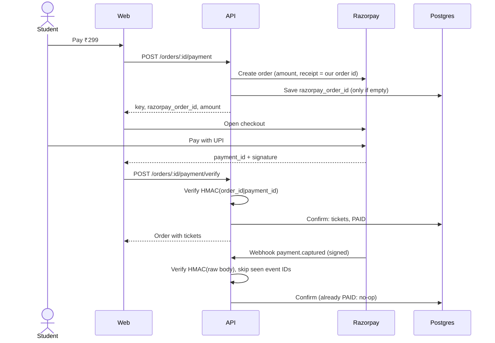

# Feature: Payments

- Status: Done
- Related ADRs: [0008](../decisions/0008-reserve-at-checkout.md), [0009](../decisions/0009-payment-confirmation.md)

## What it does

A student with a pending order pays through Razorpay (UPI, cards, net banking, wallets). Their tickets are issued as soon as the payment is confirmed, whether the confirmation comes from their browser, from Razorpay's webhook, or from FestPass checking with Razorpay later. Payments that cannot be honoured, such as a late payment for seats that were resold, are refunded automatically.

## High-level design

### What can go wrong, and what happens

| Situation                                              | Outcome                                                                                      |
| ------------------------------------------------------ | -------------------------------------------------------------------------------------------- |
| Student closes the tab right after paying              | Webhook confirms the order                                                                   |
| Webhook never arrives                                  | Before expiring the checkout, the sweep asks Razorpay; a captured payment confirms the order |
| Webhook delivered twice                                | Second delivery is skipped by event ID; confirmation is idempotent anyway                    |
| Webhook body or signature tampered with                | `400 INVALID_WEBHOOK`, nothing changes                                                       |
| Forged browser confirmation                            | `400 PAYMENT_VERIFICATION_FAILED`, order stays pending                                       |
| Payment amount differs from the order                  | Order becomes `REFUND_PENDING` and is refunded; no tickets                                   |
| Two checkout windows, two payments for one order       | First payment confirms; the second is refunded                                               |
| Payment after the checkout expired, tickets still free | Capacity is taken again and the order is confirmed                                           |
| Payment after the checkout expired, tickets resold     | `REFUND_PENDING`, then refunded; the other student keeps the seat                            |
| Refund call fails (Razorpay down)                      | Order stays `REFUND_PENDING`; the refund sweep retries every minute                          |
| Crash between refunding and saving the refund          | Next sweep finds the existing refund at Razorpay and records it instead of refunding again   |
| Razorpay keys not configured                           | `503 PAYMENTS_UNAVAILABLE`; the page explains payments are not set up                        |

## Low-level design

### Data model

Added in migration `payments`:

| Change                               | Purpose                                                          |
| ------------------------------------ | ---------------------------------------------------------------- |
| `orders.razorpay_refund_id` (unique) | The refund issued for this order                                 |
| `orders.refunded_at`                 | When it was refunded; required exactly when status is `REFUNDED` |
| `payment_webhook_events (id, event)` | Razorpay event IDs already processed                             |

`orders.razorpay_order_id` and `orders.razorpay_payment_id` were unique from the start, so one Razorpay order and one payment can only ever belong to one FestPass order.

### API

| Method | Path                              | Auth      | Description                                                 |
| ------ | --------------------------------- | --------- | ----------------------------------------------------------- |
| POST   | `/orders/:orderId/payment`        | Owner     | Create (or reuse) the Razorpay order; returns checkout data |
| POST   | `/orders/:orderId/payment/verify` | Owner     | Verify the checkout signature and confirm                   |
| POST   | `/webhooks/razorpay`              | Signature | Razorpay events (`payment.captured`, `order.paid`)          |

The webhook route is mounted before the JSON body parser and uses `express.raw`, because the signature covers the exact bytes Razorpay sent. It needs no session and is exempt from the `Origin` check, since Razorpay sends no `Origin` header.

### Background jobs (in the API process for now)

| Job                    | Every | Does                                                                                    |
| ---------------------- | ----- | --------------------------------------------------------------------------------------- |
| Reconcile, then expire | 15 s  | For overdue checkouts with a Razorpay order, look up captured payments; expire the rest |
| Refunds                | 60 s  | Refund `REFUND_PENDING` orders, reusing an existing Razorpay refund if one is found     |

Both are safe to run on several API instances: every state change is conditional on the current status.

### Modules

| Module                                    | Responsibility                                                                         |
| ----------------------------------------- | -------------------------------------------------------------------------------------- |
| `payments/razorpay.gateway.ts`            | `PaymentGateway` interface; Razorpay REST client with timeouts; HMAC helpers           |
| `payments/payments.service.ts`            | Start payment, verify browser result, webhooks, reconciliation, refunds, amount checks |
| `payments/payments.repository.ts`         | Attach Razorpay order once, webhook event log, reconciliation and refund queries       |
| `orders/orders.service.ts`                | `confirm` and `rejectPayment`, shared by every path                                    |
| `web/app/orders/[orderId]/pay-button.tsx` | Loads Razorpay checkout, sends the signed result, shows failures and dismissals        |

## Decisions and trade-offs

| Decision                                                | Why                                                                                                                           |
| ------------------------------------------------------- | ----------------------------------------------------------------------------------------------------------------------------- |
| Three confirmation paths into one idempotent step       | Fast in the normal case, correct when browsers or webhooks fail ([ADR-0009](../decisions/0009-payment-confirmation.md))       |
| Razorpay order created when the student clicks Pay      | Free orders and abandoned checkouts never call Razorpay, and the checkout transaction has no external call inside it          |
| Raw REST calls with `fetch` instead of the Razorpay SDK | Four endpoints, full control over timeouts and errors, responses validated with Zod, and the gateway is easy to fake in tests |
| `PaymentGateway` interface                              | Tests use a fake that signs with real HMAC secrets, so signature logic is exercised without network calls                     |
| Record webhook events after processing, not before      | If processing fails, Razorpay's retry runs it again instead of being skipped as a duplicate                                   |
| Amount check on every confirmation                      | A payment for the wrong amount is refunded rather than trusted                                                                |
| Refund lookup before refunding                          | Makes refunds idempotent across crashes and retries                                                                           |

## Setting up Razorpay (test mode)

1. Create a free account at razorpay.com and switch the dashboard to **Test Mode**.
2. **Settings → API Keys → Generate Test Key.** Put the key ID and secret in `apps/api/.env` as `RAZORPAY_KEY_ID` and `RAZORPAY_KEY_SECRET`.
3. **Settings → Payment Capture:** enable automatic capture.
4. **Settings → Webhooks → Add:** URL `https://<your-tunnel>/webhooks/razorpay`, events `payment.captured` and `order.paid`, and a secret you choose. Put the secret in `RAZORPAY_WEBHOOK_SECRET`.
5. Webhooks need a public URL. Locally, expose the API with a tunnel such as `cloudflared tunnel --url http://localhost:4000` or `ngrok http 4000`. Without a tunnel, payments still confirm through the browser path and reconciliation.
6. Test payments: use the test card `4111 1111 1111 1111` with any future expiry and CVV, or the UPI ID `success@razorpay`.

The three Razorpay variables must be set together; the API refuses to start with only some of them.

## Testing

- **Signatures (4 tests):** checkout and webhook HMACs, wrong secret, wrong payment, altered body, malformed hex.
- **Payments (17 tests, real Postgres and Redis, fake gateway):** one Razorpay order per order, ownership and payable states, unconfigured payments, browser confirmation, forged and mismatched signatures, webhook confirmation, redelivery, webhook after browser confirmation, tampered webhook, amount mismatch, duplicate payment refund, unknown orders, late payment after resale and refund, idempotent refunds, reconciliation of a lost webhook, and expiry of unpaid orders.
- **Mutation check:** disabling the webhook signature check or the amount check makes the relevant tests fail.
- **Manual (browser):** checkout reaches the order page, the Razorpay script loads, and paying without keys shows a clear message.

## Interview questions

**Why verify a webhook signature, and why on the raw body?**
Anyone can POST to a public URL. The HMAC proves the request came from Razorpay and was not altered. It is computed over the exact bytes sent; parsing and re-serialising JSON can change spacing or key order and break the match.

**Why compare signatures with `timingSafeEqual`?**
A normal string comparison stops at the first different character, so response times leak how much of a guess was right. A constant-time comparison takes the same time regardless.

**The browser already confirms payments. Why also handle webhooks?**
The browser is not reliable: students close tabs, lose connectivity, or their phone switches to the UPI app and never returns. The webhook comes server to server, so it is the source of truth; the browser path just makes the common case instant.

**What if Razorpay sends the same webhook twice?**
Its event ID is recorded after processing and checked first. Even if two deliveries race past that check, confirmation locks the order row and the second sees it already paid.

**How do you avoid refunding twice?**
Before refunding, the job asks Razorpay whether the payment already has a refund. If the process crashed after refunding but before saving, the next run finds and records the existing refund instead of creating another.

**What if a student pays after their seats were sold to someone else?**
The confirmation tries to issue the tickets; the unique index on active seat tickets rejects it, the order becomes `REFUND_PENDING`, and the refund job returns the money. The student who holds the seat keeps it.
