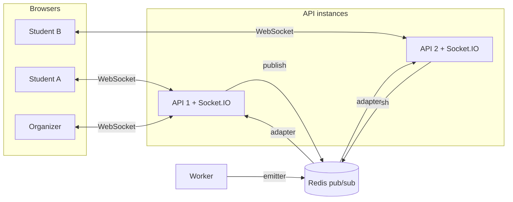

# Feature: Real-time updates

- Status: Done
- Related ADRs: [0004](../decisions/0004-seat-holds.md), [0010](../decisions/0010-worker-entry-point.md), [0011](../decisions/0011-realtime-state-messages.md)

## What it does

Everyone looking at an event sees seats change the moment someone holds, releases or buys them, and general admission counts tick down as tickets sell. Organizers get a live Sales panel with tickets sold, revenue, checkouts in progress, per-tier progress and recent orders.

## High-level design

### What triggers an update

| Change                               | Where it happens | Seats announced                          |
| ------------------------------------ | ---------------- | ---------------------------------------- |
| Student changes their seat selection | API              | Newly held and just released             |
| Checkout starts (hold extended)      | API              | The order's seats                        |
| Order confirmed (tickets issued)     | API or worker    | The order's seats                        |
| Checkout cancelled                   | API              | The order's seats                        |
| Checkout expired                     | Worker           | The expired orders' seats                |
| Late payment refunded                | API or worker    | The order's seats                        |
| Hold expires inside Redis            | Nowhere          | None: browsers release it at `heldUntil` |

Every trigger also sends updated tier counts to viewers and a `sales.updated` signal to the organizers' channel.

### Messages

| Message         | Room          | Payload                                                          |
| --------------- | ------------- | ---------------------------------------------------------------- |
| `seats.updated` | `event:<id>`  | `{ eventId, seats: [{ id, status, heldUntil }] }`                |
| `tiers.updated` | `event:<id>`  | `{ eventId, tiers: [{ id, available }] }`                        |
| `sales.updated` | `manage:<id>` | `{ eventId }`; the panel then reloads `/manage/events/:id/stats` |

The organizer message carries no figures: it tells the panel to reload, so revenue and orders only ever come from one authorized HTTP endpoint.

## Low-level design

### Connection and subscriptions

| Step              | Rule                                                                                                                                      |
| ----------------- | ----------------------------------------------------------------------------------------------------------------------------------------- |
| Handshake         | Rejected unless `Origin` is the web app (WebSockets are not covered by CORS, so this blocks cross-site WebSocket hijacking)               |
| Identity          | Read from the `fp_at` session cookie; anonymous connections are allowed                                                                   |
| `subscribe` event | `{ channel: 'event' }` is open to everyone; `{ channel: 'manage' }` requires sign-in and the organizer role, checked against the database |
| Limits            | At most 10 rooms per connection; payloads validated with Zod                                                                              |
| Acknowledgement   | `{ ok: true }` or `{ ok: false, code, message }`                                                                                          |

### Server modules

| Module                               | Responsibility                                                            |
| ------------------------------------ | ------------------------------------------------------------------------- |
| `realtime/socket-server.ts`          | Socket.IO server, Redis adapter, origin check, cookie auth, subscriptions |
| `realtime/seat-status.ts`            | Current status of seats: sold from Postgres, held and expiry from Redis   |
| `realtime/publisher.ts`              | Reads current state and emits to rooms; never throws into the caller      |
| `holds/seat-hold.store.ts`           | New: held seats with expiry, read in one Lua call using Redis 7.4 `HPTTL` |
| `events/event-management.service.ts` | New: `salesStats` for the organizer panel                                 |

### Web

| Piece                 | Behaviour                                                                                                                                  |
| --------------------- | ------------------------------------------------------------------------------------------------------------------------------------------ |
| One shared connection | `lib/realtime.ts` opens a single WebSocket per tab and re-subscribes after reconnecting                                                    |
| Seat map              | Merges `seats.updated` into the cached seats; releases holds locally at `heldUntil`; reloads after a reconnect; 60-second fallback refresh |
| General admission     | "x left" and the maximum quantity follow `tiers.updated`                                                                                   |
| Sales panel           | Live dot shows connection state; reloads figures on `sales.updated` and after reconnecting                                                 |

### API

| Method | Path                            | Auth    | Description                           |
| ------ | ------------------------------- | ------- | ------------------------------------- |
| GET    | `/manage/events/:eventId/stats` | Manager | Figures for the organizer Sales panel |
| WS     | `/socket.io`                    | Cookie  | Real-time channel                     |

## Decisions and trade-offs

| Decision                                 | Why                                                                                                                                                            |
| ---------------------------------------- | -------------------------------------------------------------------------------------------------------------------------------------------------------------- |
| Current state in every message           | Order and duplicates do not matter; a release racing a new hold cannot leave a wrong seat on screen ([ADR-0011](../decisions/0011-realtime-state-messages.md)) |
| Expiry times instead of expiry events    | Redis drops expired fields silently; sending `heldUntil` lets browsers release seats on time with no extra machinery                                           |
| Redis emitter for the worker             | The worker has no WebSocket server but must announce expiries and confirmations                                                                                |
| Organizer messages carry no numbers      | One authorized endpoint computes figures; the socket only says "something changed"                                                                             |
| Origin check on the handshake            | Browsers send cookies with WebSocket requests from any site, so the server must check where the request came from                                              |
| Publishing errors are logged, not thrown | A broken broadcast must never fail a payment or a hold                                                                                                         |

## Edge cases and failure handling

| Case                                                      | Behaviour                                                             |
| --------------------------------------------------------- | --------------------------------------------------------------------- |
| Viewer offline for a while                                | Full seat map reloads on reconnect                                    |
| Messages arrive out of order                              | Each is current state when sent; the next one corrects anything stale |
| Hold expires silently in Redis                            | Every browser releases the seat at its `heldUntil`                    |
| Redis pub/sub briefly unavailable                         | Messages are lost; the 60-second refresh restores the view            |
| Someone else's site opens a socket with the user's cookie | Handshake rejected by the origin check                                |
| A volunteer subscribes to the sales channel               | Refused: only organizers and admins pass                              |

## Testing

- **Real sockets (7 tests):** a real HTTP server with Socket.IO, the Redis adapter and emitter, and `socket.io-client` connections. They cover:
  - a hold appearing with its expiry, and released seats becoming available
  - a purchase marking seats sold and lowering tier counts
  - a worker-side expiry reaching viewers
  - cross-site connections being refused
  - the sales channel's sign-in and role checks
  - organizer notifications, plus the stats endpoint and its permissions
- **Hold store:** expiry times for all held seats and for specific seats.
- **Mutation check:** removing the hold broadcast or the role check makes the relevant tests fail.
- **Manual (two tabs):**
  - selecting a seat in one tab showed it as "being booked" in the other without reloading
  - starting and cancelling checkout moved the organizer's "checking out now" from 0 to 1 and back, live

## Interview questions

**How do updates reach users connected to different servers?**
Socket.IO's Redis adapter: each API instance publishes room messages to Redis and receives everyone else's, then delivers to its own connections. The worker uses the Redis emitter to publish into the same channels without running a socket server.

**Why send the seat's current state instead of "seat released"?**
Events can race. If a checkout expires while another student is holding the same seat, a "released" event arriving last would show a held seat as free. Reading the actual state just before sending means the latest message is always right, and applying a message twice is harmless.

**Redis expires holds silently. How do browsers know?**
Every held seat comes with the time its hold ends. Browsers set a timer and release it locally at that moment, so no server message is needed.

**What happens if a user's connection drops?**
Socket.IO reconnects automatically. On reconnect the client reloads the full seat map, because messages sent while it was offline are gone.

**How is the WebSocket protected?**
The handshake is refused unless it comes from the FestPass web origin, because cookies are sent with cross-site WebSocket requests. The session cookie identifies the user, and joining an organizer room is checked against the database just like the HTTP API.
