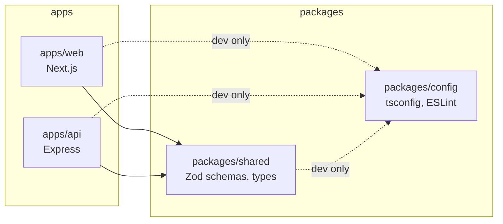

# Feature: Project setup

- Status: Done
- Related ADRs: [0001](../decisions/0001-monorepo.md), [0002](../decisions/0002-separate-express-api.md)

## What it does

Sets up the monorepo every later feature builds on: a Next.js web app and an Express API sharing types and configuration, with linting, type checking, tests, formatting, commit checks, local databases in Docker and a CI pipeline.

## High-level design



`turbo run check` runs `lint`, `typecheck`, `test` and `build` across every package in dependency order, caching results so unchanged packages are skipped.

### How shared code is consumed

`packages/shared` is an internal package that exports TypeScript source directly (`"exports": { ".": "./src/index.ts" }`), with no build step of its own.

| Consumer             | How it handles the TypeScript                                                                |
| -------------------- | -------------------------------------------------------------------------------------------- |
| `web`                | `transpilePackages: ['@festpass/shared']` in `next.config.ts`                                |
| `api` in development | `tsx` runs TypeScript directly                                                               |
| `api` in production  | `tsdown` bundles the API and inlines `@festpass/*` packages into one file, `dist/server.mjs` |
| Tests                | Vitest transforms TypeScript itself                                                          |

## Low-level design

### API foundation (`apps/api/src`)

| File                              | Responsibility                                                                                              |
| --------------------------------- | ----------------------------------------------------------------------------------------------------------- |
| `config/env.ts`                   | Validates environment variables with Zod; reports every invalid variable at once                            |
| `lib/logger.ts`                   | Pino logger; pretty output in development, JSON elsewhere; redacts auth headers and cookies                 |
| `lib/errors.ts`                   | `AppError` and subclasses (`ValidationError`, `NotFoundError`, `ConflictError`, ...) carrying status + code |
| `middleware/http-logger.ts`       | Request logging and request IDs                                                                             |
| `middleware/error-handler.ts`     | Converts any error into the shared error response shape                                                     |
| `modules/health/health.routes.ts` | `GET /health` liveness check                                                                                |
| `app.ts`                          | `createApp({ env, logger })`: builds the Express app from its dependencies                                  |
| `server.ts`                       | Process entry: loads env, starts listening, handles shutdown signals and fatal errors                       |

Middleware order in `createApp`:

1. HTTP logger (first, so every later log line and error has a request ID)
2. Helmet security headers
3. CORS, allowing only `WEB_ORIGIN`, with credentials
4. JSON body parser with a 100 KB limit
5. Routes
6. 404 handler
7. Error handler (last)

### API

| Method | Path      | Auth | Description                  |
| ------ | --------- | ---- | ---------------------------- |
| GET    | `/health` | None | Returns `{ "status": "ok" }` |

Every error, from any endpoint, has the same shape, defined once in `packages/shared` as `apiErrorResponseSchema`:

```json
{
  "error": {
    "code": "NOT_FOUND",
    "message": "Route GET /nope does not exist.",
    "requestId": "68d8b3cc-b6b1-414e-8179-68e7ef7d09d7"
  }
}
```

### Web foundation (`apps/web`)

- Design tokens from the [design system](../05-design-system.md) are CSS variables in `globals.css`, exposed to Tailwind with `@theme inline`.
- Tailwind's default colours, fonts, radii and shadows are reset with `--color-*: initial` and similar, so only design-system tokens exist as classes. Using `bg-blue-500` or `rounded-lg` does not compile to anything, which keeps off-system styles out of the codebase.
- Fonts load through `next/font/google` (self-hosted at build time, no layout shift).
- Dark mode follows the operating system, and can be forced with `data-theme="light"` or `data-theme="dark"` on `<html>`.

## Decisions and trade-offs

| Decision                                                                    | Why                                                                                                                   |
| --------------------------------------------------------------------------- | --------------------------------------------------------------------------------------------------------------------- |
| TypeScript 6.0, not 7                                                       | typescript-eslint supports TypeScript below 6.1; type-aware lint rules matter more than the faster compiler           |
| ESLint 9, not 10                                                            | `eslint-plugin-react`, used by Next.js's ESLint config, does not support ESLint 10 yet                                |
| Type-aware lint rules (`strictTypeChecked`)                                 | Catches floating promises, unsafe `any` and unnecessary conditions, at the cost of slower linting                     |
| Internal packages export source, apps bundle                                | No build or watch step for shared packages; one production artifact for the API                                       |
| `createApp` takes dependencies instead of reading globals                   | Tests build the app with a silent logger and fixed config, without touching `process.env`                             |
| Client-supplied `X-Request-Id` accepted only if it matches `^[\w-]{1,128}$` | Lets a load balancer or the web app pass a trace ID through, without letting a client inject arbitrary text into logs |
| Logs keep only request id, method, URL and status                           | Full header dumps are noisy and risk leaking sensitive data                                                           |
| `pnpm` build scripts allow-listed (`allowBuilds`)                           | Dependencies cannot run install scripts unless approved; only `esbuild` is allowed                                    |
| Commit scopes restricted by commitlint                                      | Keeps history searchable by area (`feat(booking): ...`)                                                               |

## Edge cases and failure handling

| Case                                      | Behaviour                                                                          |
| ----------------------------------------- | ---------------------------------------------------------------------------------- |
| Missing or invalid environment variable   | Process exits at startup with every problem listed                                 |
| Malformed JSON body                       | `400 INVALID_JSON`                                                                 |
| Body over 100 KB                          | `413 PAYLOAD_TOO_LARGE`                                                            |
| Unknown route                             | `404 NOT_FOUND`                                                                    |
| Unexpected exception                      | Logged with request ID and stack; client sees a generic `500 INTERNAL_ERROR`       |
| `SIGTERM` / `SIGINT`                      | Stops accepting connections, finishes in-flight requests, exits; forced after 10 s |
| Unhandled rejection or uncaught exception | Logged as fatal; process exits so the platform restarts it in a clean state        |

## Testing

`apps/api` has 9 tests (Vitest + Supertest):

- Environment parsing: defaults, coercion, and reporting of every invalid variable
- `/health` response
- Error shape for 404, malformed JSON and oversized bodies, validated against the shared schema
- Request ID reuse and replacement of unsafe IDs
- CORS headers for the web origin

## Interview questions

**Why a monorepo?**
The web app and API share request and response types. In one repository, a change to a schema and every place that uses it land in one commit, and the type checker catches mismatches before they reach production.

**Why does the error handler come last in Express?**
Express identifies error handlers by their four arguments and only calls them when an earlier middleware or route passes an error. Registered last, it catches errors from everything above it. Express 5 also forwards rejected promises from async handlers, so no wrapper is needed.

**Why exit on an uncaught exception instead of continuing?**
After an unexpected exception, the process may be in an inconsistent state (half-finished operations, leaked connections). Exiting and letting the platform restart it is safer than serving requests from unknown state.

**What does graceful shutdown do?**
On `SIGTERM`, which platforms send before stopping a container, the server stops accepting new connections and waits for in-flight requests to finish, so deploys do not cut off users mid-request. A timeout prevents a stuck request from blocking shutdown forever.

**Why validate environment variables at startup?**
A missing variable should fail the deploy immediately with a clear message, not surface hours later as an `undefined` deep in a request.

**What are request IDs for?**
Every log line for a request carries the same ID, and the ID is returned in the `X-Request-Id` header and error body. When a user reports an error, the ID finds every related log line.
