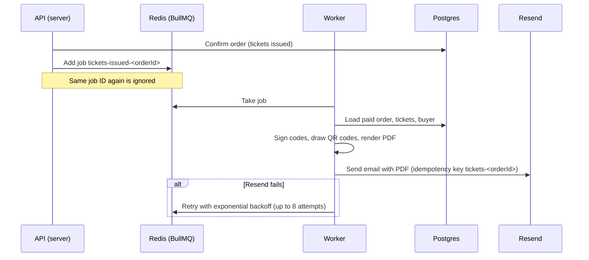

# Feature: Tickets, QR codes and email

- Status: Done
- Related ADRs: [0009](../decisions/0009-payment-confirmation.md), [0010](../decisions/0010-worker-entry-point.md)

## What it does

When an order is confirmed, every ticket gets a signed QR code. The buyer sees the tickets on the order page, can download them as a PDF, and receives an email with the PDF attached. All email, including sign-up verification and password resets, is sent by a background worker with automatic retries.

## High-level design



### Queues

| Queue         | Jobs                                                        | Retries                       | Concurrency per worker |
| ------------- | ----------------------------------------------------------- | ----------------------------- | ---------------------- |
| `email`       | Verification, password reset, any text email                | 8 attempts, backoff from 15 s | 5                      |
| `tickets`     | `deliver` one order's tickets                               | 8 attempts, backoff from 15 s | 2                      |
| `maintenance` | `expire-checkouts` every 15 s, `process-refunds` every 60 s | Next scheduled run            | 1                      |

Maintenance jobs come from BullMQ job schedulers, so with several worker processes each run still happens once.

## Low-level design

### Ticket codes

```
FP1.<ticket uuid>.<signature>
signature = first 16 bytes of HMAC-SHA256(TICKET_SIGNING_SECRET, "FP1.<ticket uuid>"), base64url
```

| Property                          | How                                                                                      |
| --------------------------------- | ---------------------------------------------------------------------------------------- |
| Cannot be forged                  | Needs the server-side secret; 128-bit signature                                          |
| Cannot be moved to another ticket | The signature covers the ticket ID                                                       |
| Small QR code                     | About 80 characters, so a low-density code that scans quickly in poor light              |
| Versioned                         | `FP1` prefix lets the format change later without breaking printed tickets               |
| Separate secret                   | `TICKET_SIGNING_SECRET` is not the JWT secret, so rotating one does not affect the other |

The code proves a ticket is genuine; whether it has already been used is decided by the check-in record in Postgres.

### PDF

- One page per ticket, 595 × 300 pt, drawn with PDFKit: paper background, marigold edge, event name in Big Shoulders, seat and tier in large type, holder's name, and a perforated stub with the QR code on white and the ticket reference.
- QR codes use error correction level M, so a slightly creased printout still scans.
- The same renderer serves the download endpoint and the email attachment.

### Email delivery

| Sender              | Used when                            | Behaviour                                               |
| ------------------- | ------------------------------------ | ------------------------------------------------------- |
| `QueuedEmailSender` | In the API                           | Adds a job to the `email` queue and returns immediately |
| `ResendEmailSender` | In the worker, with `RESEND_API_KEY` | Sends through Resend with an idempotency key per job    |
| `LogEmailSender`    | In the worker, without a provider    | Logs the message and attachment sizes                   |

Attachments are never put on the queue. The API queues only the order ID; the worker renders the PDF itself, keeping Redis small and the PDF current.

### API

| Method | Path                           | Auth  | Description                                |
| ------ | ------------------------------ | ----- | ------------------------------------------ |
| GET    | `/orders/:orderId`             | Owner | Order; each ticket now includes its `code` |
| GET    | `/orders/:orderId/tickets.pdf` | Owner | All tickets of a paid order as one PDF     |

### Web

- The order page shows each ticket as a stub with its QR code drawn as SVG from the QR module grid, on white even in dark mode, with an accessible label.
- "Download PDF" links straight to the API with the session cookie.

## Decisions and trade-offs

| Decision                                                     | Why                                                                                                              |
| ------------------------------------------------------------ | ---------------------------------------------------------------------------------------------------------------- |
| Signed codes instead of random tokens stored in the database | A scanner can reject a fake code before any lookup, and the check-in phase can verify codes cheaply              |
| Truncated HMAC (128 bits)                                    | Same forgery resistance in practice as the full 256 bits, and a smaller, faster-scanning QR code                 |
| Deduplicate delivery by job ID                               | Payments can be confirmed by the browser, the webhook and reconciliation; the student still gets one email       |
| Email idempotency key at Resend                              | A worker that crashes after sending but before marking the job done does not send a second email on retry        |
| Queue failure does not undo the payment                      | If Redis is down at confirmation, the order is still paid and tickets are on the order page; the error is logged |
| PDFKit instead of rendering HTML in a headless browser       | Milliseconds per ticket and no Chromium in the worker image                                                      |
| QR drawn from the module grid on the web                     | No `dangerouslySetInnerHTML`, and the ticket code never leaves the browser for an external QR service            |

## Edge cases and failure handling

| Case                                         | Behaviour                                                                                 |
| -------------------------------------------- | ----------------------------------------------------------------------------------------- |
| Order confirmed twice                        | Only the first confirmation queues delivery; the job ID blocks duplicates                 |
| Resend down                                  | Job retries with exponential backoff for about an hour, then is kept as failed for 7 days |
| Worker crashes mid-job                       | BullMQ re-delivers the job when its lock expires                                          |
| Order refunded or not paid when the job runs | Job finishes as `skipped`; nothing is sent                                                |
| PDF requested before payment                 | `409`                                                                                     |
| Someone else's order                         | `404`                                                                                     |
| Tampered QR code                             | Fails signature verification                                                              |

## Testing

- **Ticket codes (10 tests):** round trip, other secret, signature moved to another ticket, malformed input.
- **Tickets (8 tests, real Postgres and Redis):** one PDF page per ticket, signed codes on orders, delivery queued exactly once, not queued for unpaid orders, PDF download for owner only and only once paid, ticket email with the PDF attached, unpaid orders skipped.
- **Queues (3 tests, real BullMQ):** a queued email is delivered by a worker; attachments are refused on the queue; repeated delivery requests for one order produce one job.
- **Manual (browser):** free ticket, QR code on the order page, PDF download, and the worker sending the ticket email with the PDF attached.

## Interview questions

**How do you stop someone forging a ticket QR code?**
The code contains the ticket ID and an HMAC of it made with a secret only the server knows. Without the secret, nobody can produce a valid signature, and a valid signature cannot be moved to a different ticket ID.

**A signed code can still be photographed and shared. How is that handled?**
The signature proves authenticity, not single use. Check-in records each ticket once under a unique constraint, so the second person with a copied code is refused.

**Why send email from a queue instead of in the request?**
The student should not wait on an email provider, and if the provider is down the message should be retried, not lost. The API adds a job in about a millisecond; the worker retries with backoff until it succeeds.

**How do you make sure the ticket email is sent once?**
Twice over. The delivery job's ID is derived from the order ID, so repeated confirmations cannot queue a second job. And the email request to Resend carries an idempotency key, so a retry after a crash does not send it again.

**Why is the worker part of the API codebase?**
Its jobs need the same domain logic as the API: orders, payments, seat holds. Two entry points in one codebase keep that logic in one place while letting the processes run and scale separately ([ADR-0010](../decisions/0010-worker-entry-point.md)).
